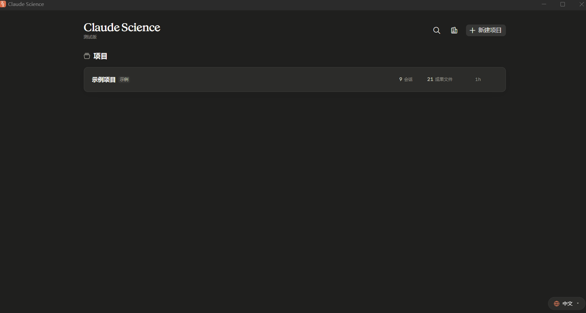

<h1 align="center">Claude Science 中文汉化补丁</h1>

<p align="center">
  
</p>

<p align="center">一个用于 Claude Science Windows 桌面端的中文界面汉化补丁，支持简体中文 / English 语言切换，即装即用。</p>

## 功能特点

- **一键安装**：`node build-runtime.cjs` 自动探测 web-dist 目录，无需手动找路径。
- **中英双语切换**：右下角常驻「🌐 语言」按钮，可随时在 中文(简体) / English 之间切换，切回英文后界面与原始安装完全一致。
- **改词立生效**：翻译词条放在 JSON 词典里，改完刷新页面即生效，**无需重新打包**。
- **不重打包应用**：唯一改动是往 `index.html` 注入一个脚本，不触碰应用可执行文件，不动资源 chunk。
- **安全可回滚**：安装前自动备份；一键完整还原英文版。

> 本补丁只读写本机 `~/.claude-science/runtime/<版本>/web-dist`，不联网、不改应用主程序。

## 界面截图



## 适用环境

- Windows（原生 Windows 版 Claude Science）
- 已安装 Claude Science `0.1.70`（web-dist 出现在 `~/.claude-science/runtime/0.1.70-release/web-dist`）
- 需要 [Node.js](https://nodejs.org/)（`build-runtime.cjs` 运行用）

## 使用方式

### 安装

```powershell
# 1) 下载本项目并进入目录
cd claude-science-zh

# 2) 安装依赖（apply.cjs 需要 acorn）
npm install

# 3) 注入汉化脚本（自动探测 web-dist，通常无需指定路径）
node build-runtime.cjs
```

如果自动探测失败（例如不是在默认用户目录），可手动指定 web-dist 路径：

```powershell
node build-runtime.cjs "C:\<你>\.claude-science\runtime\0.1.70-release\web-dist"
```

安装完成后**刷新 Claude Science 窗口**（`Ctrl+R`）即可看到中文界面。
若右下角没有出现「🌐 语言」按钮，改用强制刷新（`Ctrl+Shift+R`）。

### 切换语言

- 界面右下角点击「🌐 语言」按钮：
  - 选择 **中文（简体）** → 界面变为中文
  - 选择 **English** → 界面恢复英文

### 加词 / 改翻译

想调整某个翻译，或应用升级后补齐新文案：

```powershell
# 1) 打开词典文件（JSON），键 = 英文原文，值 = 中文
#    zh-CN-0.1.70.json / zh-CN-longtail.json / zh-CN-config.json 等任选

# 2) 重新生成运行时词典
node build-runtime.cjs

# 3) 刷新页面即生效
```

### 回滚 / 卸载

提供三种粒度，任选其一：

1. **界面内切回英文**：点「🌐 语言」→ English（补丁仍在，只是显示英文）。
2. **摘掉注入**：删除 `index.html` 里那行 `<script src="./assets/zh-runtime.js...">`。
3. **完整还原**：`node restore.cjs`（从 `.backup/` 还原被改动过的文件）。

应用更新后清掉脏数据重装即可，详见下方「更新后处理」。

---

## 文件说明

| 文件 | 作用 |
|---|---|
| `build-runtime.cjs` | 合并词典 → 生成 `assets/zh-cn.json` + 注入 `<script>`（核心安装/更新入口） |
| `zh-runtime.js` | 运行时翻译层，负责中英切换与节点替换 |
| `dicts.cjs` | 词典合并入口 |
| `apply.cjs` | 可选静态补丁，用于彻底消除首屏英文闪烁 |
| `restore.cjs` | 从 `.backup/` 还原英文 |
| `extract4.cjs` | 找出还没翻译的界面文案（数据驱动下一批翻译） |
| `zh-CN-0.1.70.json` | 主线核心词典（对应 Claude Science 0.1.70） |
| `zh-CN-config.json` / `zh-CN-connectors.json` / `zh-CN-model-auth.json` / `zh-CN-session.json` | 分区域词条（配置/连接器/模型授权/会话） |
| `zh-CN-misc-6.json` … `zh-CN-misc-10.json` | 杂项补丁批次 |
| `zh-CN-longtail.json` | 长尾补词 |
| `kit/zh-CN.json`、`kit/zh-CN-extra.json` | 早期积累基础词条 |
| `docs/汉化工作流.md` | 给维护者的完整实现与实测记录 |

---

## 脚本会做什么

`build-runtime.cjs` 执行以下操作（全部在 `web-dist` 内完成）：

1. 合并所有词典文件，生成 `assets/zh-cn.json`（约两千条翻译）。
2. 复制 `zh-runtime.js` 到 `assets/`。
3. 在 `index.html` 的 `</head>` 前插入一行脚本标签（幂等，重复执行不会重复注入）。
4. 自动探测 web-dist 目录；也可用 `CS_WEB_DIST` 环境变量或命令行参数指定路径。

`apply.cjs` 是可选的**静态**补丁：把 `children` 等行程内的英文字符串直接替换成中文，用于消除首屏短暂英文闪烁。**默认不用**，需要时：

```powershell
node apply.cjs
node build-runtime.cjs   # apply 会重写 index.html，需重建脚本注入
```

> 顺序：先 `apply.cjs` 再 `build-runtime.cjs`，后者负责把脚本标签重新插回去。

---

## 更新后处理

Claude Science 升级后，web-dist 版本目录会变化，只需：

1. 用新版 web-dist 路径重跑 `node build-runtime.cjs`（自动探测新版本目录）。
2. 若仍有界面文案未汉化，用 `extract4.cjs` 找出"漏网之鱼"并补齐词典。
3. 若脚本有修改，请同步更新 `build-runtime.cjs` 里的缓存版本号（见下）。

> **缓存版本号说明**：浏览器会按脚本 URL 缓存。改过 `zh-runtime.js` 后，需要把
> `build-runtime.cjs` 里的脚本版本号 +1，让 URL 变化以绕过缓存，否则页面会一直加载旧脚本。
> 这是为绕过浏览器缓存，与应用版本号无关。

---

## 覆盖范围与保留

**已汉化：**

- 主界面项目列表、侧边栏按钮（`aria-label`）、设置与自定义面板导航（技能/连接器/专业助手/记忆/计算资源/网络/权限/凭据/存储/用量/常规）
- 项目对话框（名称/描述/给 Claude 的指令/占位符/示例句）
- 网络面板等

**有意保留英文：**

1. 会话正文、技能正文、图表标注、文件名 —— 这是**数据**，不应翻译。
2. 品牌名 / 字体名 / 套餐名（`Claude Science`、`Anthropic Sans`、`Max`）。
3. daemon 自行生成的 HTML（如登录中转页、错误页），不在 web-dist 目录内，属另一层。

新版本新增、尚未翻译的字段会**保留英文**，不影响使用。

---

## 免责声明

本项目为非官方中文补丁，仅修改本机 Claude Science 桌面端的本地 web-dist 资源文件。
应用升级后 web-dist 结构可能变化，若补丁失效，请重新运行 `build-runtime.cjs` 或更新本项目。

## License

[MIT](LICENSE)